# 10. Diagramas UML

Este capítulo presenta los diagramas UML de UCO Kudos. Los diagramas de **casos de uso**, **clases** y **actividad** están en draw.io (`docs/diagramas/*.drawio`), para poder editarlos. Los de **secuencia** y **estado** están escritos en Mermaid dentro de este archivo: GitHub los dibuja directamente.

| Diagrama | Archivo | Qué responde |
|---|---|---|
| 10.1 Casos de uso | `diagramas/casos_uso_kudos.drawio` | ¿Quién usa el sistema y para qué? |
| 10.2 Clases (3 páginas) | `diagramas/diagrama_clases_kudos.drawio` | ¿Qué objetos existen, qué saben y qué hacen? |
| 10.3 Secuencia | Mermaid (abajo) | ¿Cómo colaboran las capas en una operación? |
| 10.4 Actividad (7 páginas) | `diagramas/diagramas_actividades_kudos.drawio` | ¿Qué pasos sigue un proceso de principio a fin? |
| 10.5 Estado | Mermaid (abajo) | ¿Por qué estados pasa un objeto y qué los cambia? |

---

## 10.1 Diagrama de casos de uso

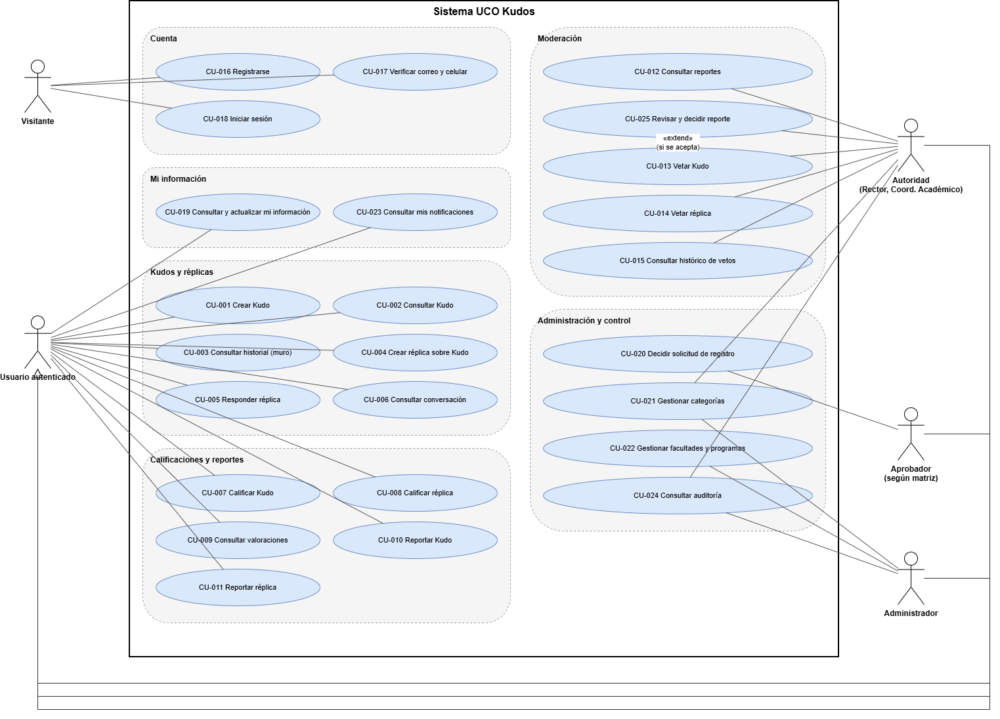

Los casos CU-001 a CU-015 vienen del enunciado. Los CU-016 a CU-025 se agregaron porque el enunciado describe esas funciones (registro, aprobación, gestión institucional, auditoría) pero no les asigna número.

**Actores.** Todos los roles son *usuarios autenticados* (generalización): un Rector también puede dar Kudos. Se agruparon según lo que pueden hacer de más:

| Actor | Roles | Qué agrega |
|---|---|---|
| Visitante | Cualquier persona de la comunidad sin sesión | Registrarse, verificar sus datos e iniciar sesión |
| Usuario autenticado | Los 7 roles | Kudos, réplicas, calificaciones, reportes, notificaciones |
| Autoridad | Rector, Coordinador Académico | Revisar reportes y vetar (permisos `REVISAR_REPORTES`, `VETAR`) |
| Aprobador | Rol aprobador según la matriz (Admin, Rector, Coord. Académico, Coord. Facultad, Coord. Programa) | Aprobar o rechazar solicitudes de registro |
| Administrador | Administrador | Gestionar facultades y programas (`GESTIONAR_ESTRUCTURA`) |

**Trazabilidad caso de uso → implementación**

| Caso de uso | Endpoint | Clase de negocio |
|---|---|---|
| CU-001 Crear Kudo | `POST /api/v1/kudos` | `KudoNegocioImpl.crearKudo` |
| CU-002 Consultar Kudo | `GET /api/v1/kudos/{id}` | `KudoNegocioImpl.consultarKudo` |
| CU-003 Consultar historial | `GET /api/v1/kudos?idDestinatario=` | `KudoNegocioImpl.consultarMuro` |
| CU-004 / CU-005 Crear réplica / responder réplica | `POST /api/v1/replicas` | `ReplicaNegocioImpl.crearReplica` |
| CU-006 Consultar conversación | `GET /api/v1/kudos/{id}/replicas` | `ReplicaNegocioImpl.consultarConversacion` |
| CU-007 / CU-008 Calificar | `PUT /api/v1/publicaciones/{id}/calificacion` | `CalificacionNegocioImpl.calificar` |
| CU-009 Consultar valoraciones | `GET /api/v1/publicaciones/{id}/calificaciones` | `CalificacionNegocioImpl.consultarResumen` |
| CU-010 / CU-011 Reportar | `POST /api/v1/publicaciones/{id}/reportes` | `ReporteNegocioImpl.reportar` |
| CU-012 Consultar reportes | `GET /api/v1/reportes?estado=` | `ReporteNegocioImpl.consultarReportes` |
| CU-013 / CU-014 Vetar | `POST /api/v1/publicaciones/{id}/veto` | `VetoNegocioImpl.vetar` |
| CU-015 Histórico de vetos | `GET /api/v1/auditoria?accion=PUBLICACION_VETADA` | `AuditoriaNegocioImpl.consultarAuditoria` |
| CU-016 Registrarse | `POST /api/v1/usuarios` | `UsuarioNegocioImpl.registrarUsuario` |
| CU-017 Verificar correo y celular | `POST /api/v1/usuarios/verificaciones` | `VerificacionContactoNegocioImpl.verificarCodigo` |
| CU-018 Iniciar sesión | `POST /api/v1/sesiones` | `UsuarioNegocioImpl.iniciarSesion` |
| CU-019 Mi información | `GET` y `PUT /api/v1/usuarios/yo` | `UsuarioNegocioImpl.actualizarMiInformacion` |
| CU-020 Decidir solicitud | `POST /api/v1/solicitudes/{id}/aprobar` y `/rechazar` | `SolicitudRegistroNegocioImpl` |
| CU-021 Gestionar categorías | `POST`, `PUT`, `PATCH /api/v1/categorias` | `CategoriaNegocioImpl` |
| CU-022 Gestionar facultades y programas | `POST /api/v1/facultades`, `POST /api/v1/programas` | `FacultadNegocioImpl`, `ProgramaAcademicoNegocioImpl` |
| CU-023 Mis notificaciones | `GET /api/v1/notificaciones` | `NotificacionNegocioImpl` |
| CU-024 Consultar auditoría | `GET /api/v1/auditoria` | `AuditoriaNegocioImpl` |
| CU-025 Revisar y decidir reporte | `POST /api/v1/reportes/{id}/revision`, `/aceptar`, `/rechazar` | `ReporteNegocioImpl.iniciarRevision` y `decidir` |

---

## 10.2 Diagrama de clases

El diagrama muestra la **capa de dominio**, que es donde viven las reglas. Está dividido en tres páginas para que se pueda leer:

1. **Usuarios y estructura:** `Usuario` en el centro, con su `Rol`, sus verificaciones, sus solicitudes y su vinculación a la estructura académica.
2. **Publicaciones y moderación:** la herencia `Publicacion` → `Kudo` / `Replica` y las clases que actúan sobre una publicación (`Calificacion`, `Reporte`, `Veto`).
3. **Enumeraciones:** estados y tipos con sus valores.

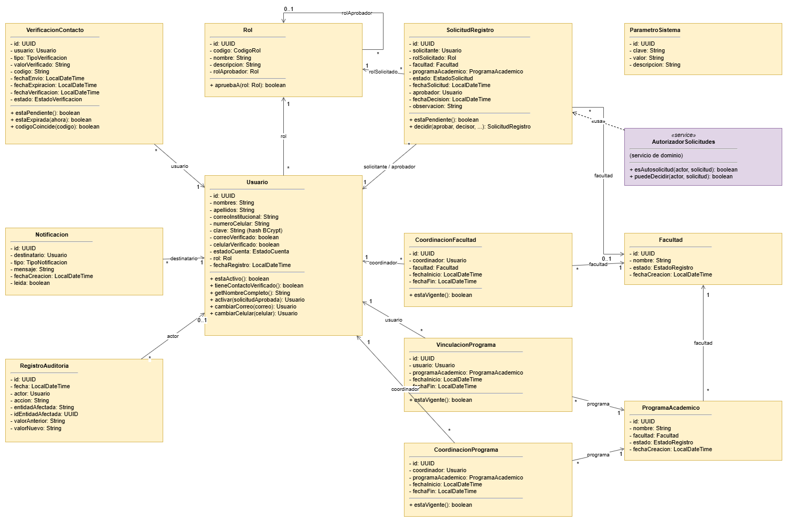

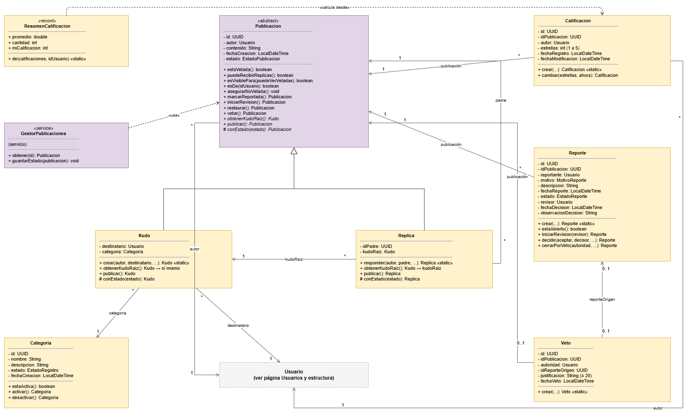

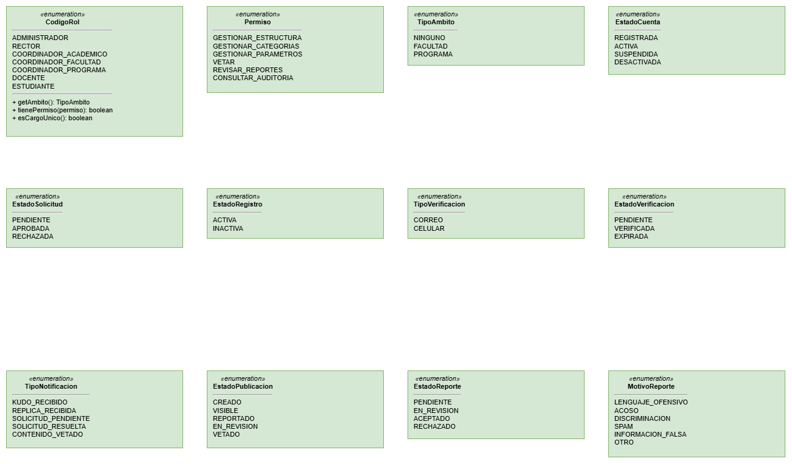

**Decisiones que se ven en el diagrama**

1. **`Publicacion` es abstracta.** Tiene lo común y las transiciones de estado. Las hijas solo implementan lo que cambia: `obtenerKudoRaiz()` (el Kudo se devuelve a sí mismo y la Réplica devuelve su raíz) y `conEstado()` (cada una construye su copia). Por eso, al responder, una réplica nunca pregunta de qué tipo es su padre (**polimorfismo**).
2. **El rol es un atributo, no una herencia.** Un `Usuario` tiene un `Rol`, y `CodigoRol` sabe sus permisos y su ámbito. Si los roles fueran subclases, cambiar a alguien de rol obligaría a cambiar su clase.
3. **Objetos inmutables con Builder.** No hay *setters*: los métodos de comportamiento (`activar`, `decidir`, `vetar`…) devuelven un objeto nuevo.
4. **Métodos `crear(...)` estáticos** en `Kudo`, `Replica`, `Calificacion`, `Reporte` y `Veto`. Así no puede existir un objeto que incumpla sus reglas desde que nace, por ejemplo un Kudo a uno mismo o un veto sin justificación.
5. **Servicios de dominio** (`AutorizadorSolicitudes`, `GestorPublicaciones`) para las reglas que necesitan varios objetos a la vez y no pertenecen a uno solo.

---

## 10.3 Diagramas de secuencia

### 10.3.1 CU-001 Crear Kudo

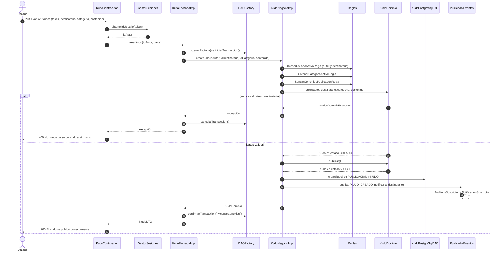

Lo que muestra: el **controlador** solo traduce HTTP, la **fachada** maneja la transacción (*Template Method*), el **negocio** orquesta las reglas, el **dominio** protege sus invariantes y los **eventos** hacen la auditoría y la notificación sin que el negocio sepa cómo (*Observer*). Si algo falla en cualquier punto, la transacción se cancela y no queda nada a medias.

### 10.3.2 CU-025 Aceptar un reporte (produce el veto)

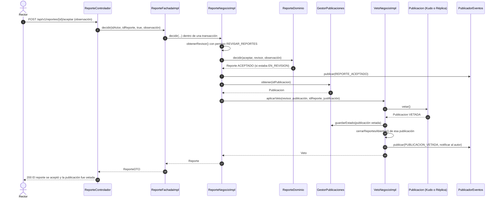

---

## 10.4 Diagramas de actividad

Los diagramas de actividad siguen la estructura vista en clase: un **nodo inicial**, las **actividades** de izquierda a derecha, un **rombo de decisión** después de cada validación, el **mensaje de error** debajo de cada decisión que falla, una **barra de sincronización** que reúne todos los finales y el **nodo final**. Antes de guardar un objeto nuevo aparece el bucle de **generar el identificador y validar que no exista** (si existe, se vuelve a generar).

Están en `diagramas/diagramas_actividades_kudos.drawio`, una página por caso de uso:

| Página | Caso de uso | Imagen |
|---|---|---|
| 1 | CU-016 Registrarse | `actividad_registrarse.png` |
| 2 | CU-018 Iniciar sesión | `actividad_iniciar_sesion.png` |
| 3 | CU-001 Crear Kudo | `actividad_crear_kudo.png` |
| 4 | CU-004 y CU-005 Crear réplica | `actividad_crear_replica.png` |
| 5 | CU-007 y CU-008 Calificar publicación | `actividad_calificar.png` |
| 6 | CU-010 y CU-011 Reportar publicación | `actividad_reportar.png` |
| 7 | CU-025 Decidir reporte | `actividad_decidir_reporte.png` |

### 10.4.1 Registrarse

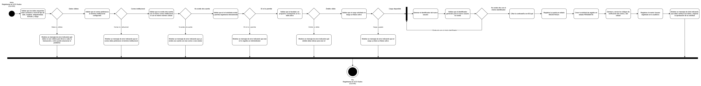

### 10.4.2 Iniciar sesión

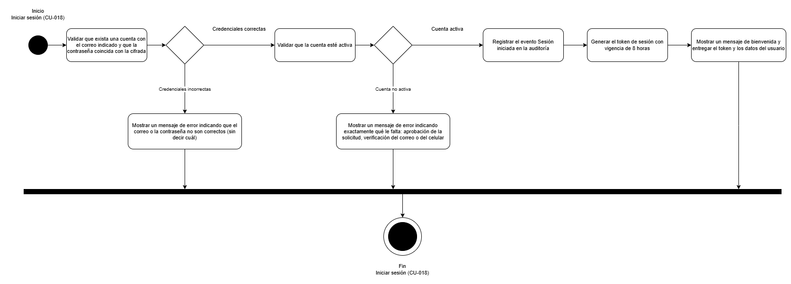

### 10.4.3 Crear Kudo

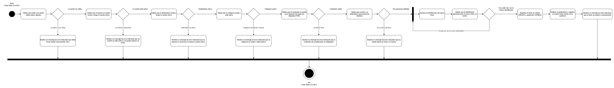

### 10.4.4 Crear réplica

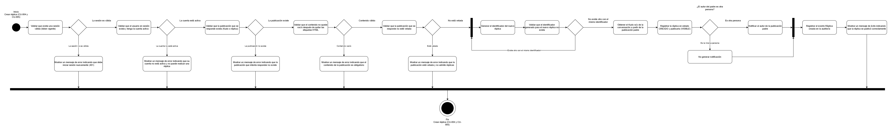

### 10.4.5 Calificar publicación

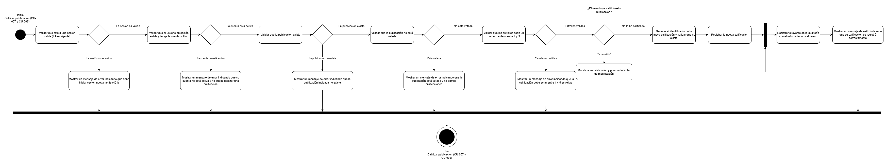

### 10.4.6 Reportar publicación

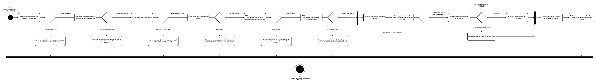

### 10.4.7 Decidir reporte

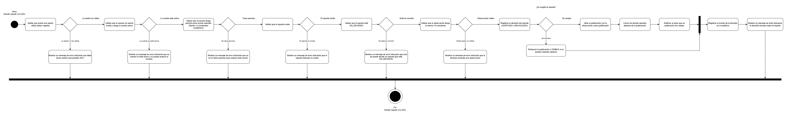

Cada validación de estos diagramas corresponde a una regla del código (por ejemplo, *Validar que el autor y el destinatario sean personas distintas* es `KudoDominio.crear()`, KUD-P-0002), y cada mensaje de error es un texto de `CatalogoMensajes`.

---

## 10.5 Diagramas de estado

### 10.5.1 Publicación (Kudo o Réplica)

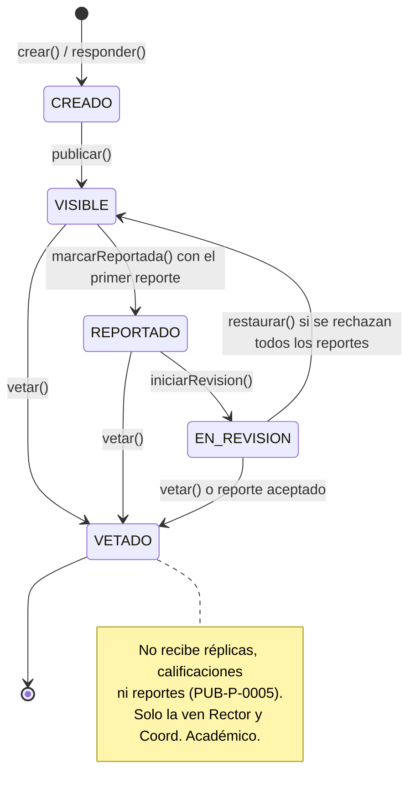

Cada flecha es un método de `PublicacionDominio`. Una transición que no está dibujada lanza una excepción del dominio (PUB-P-0004).

### 10.5.2 Reporte

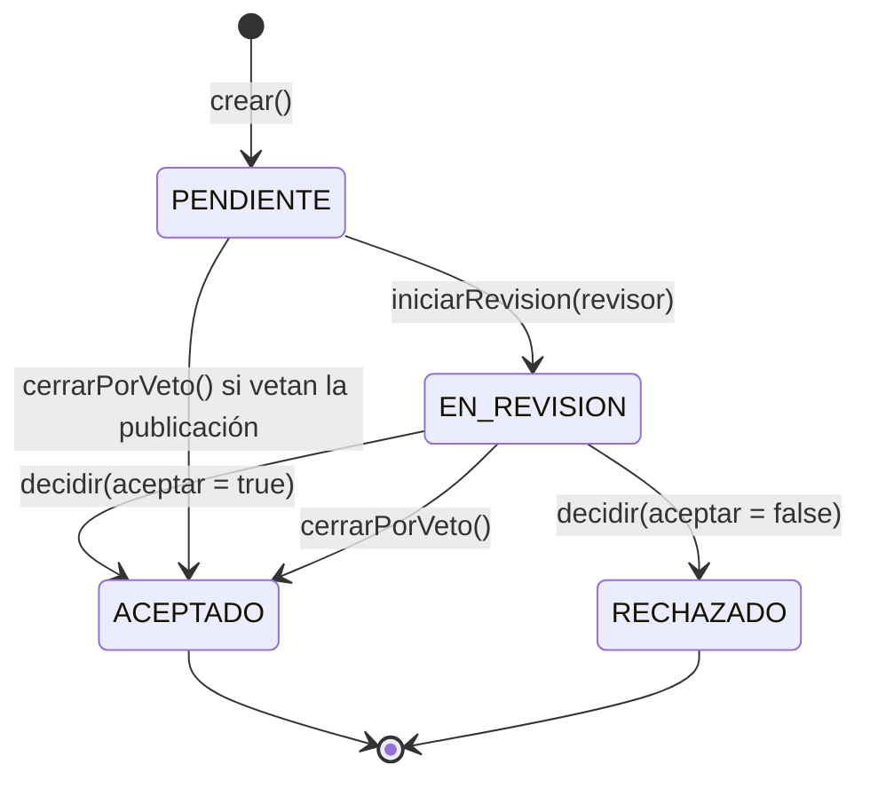

### 10.5.3 Cuenta de usuario

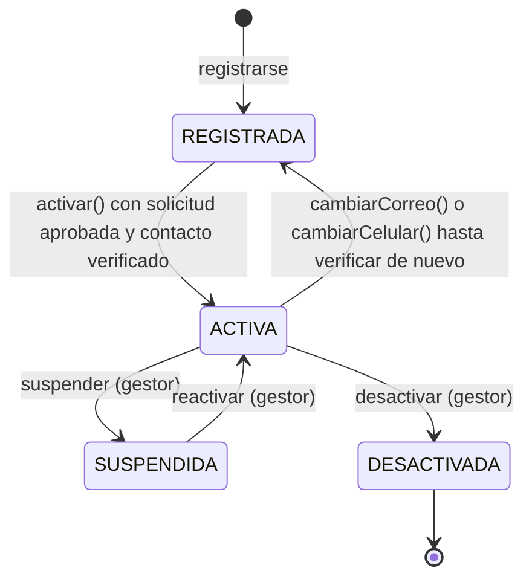

La suspensión y la desactivación están en el modelo y en la base de datos, pero aún no tienen endpoint. Quedan como trabajo futuro.

### 10.5.4 Solicitud de registro

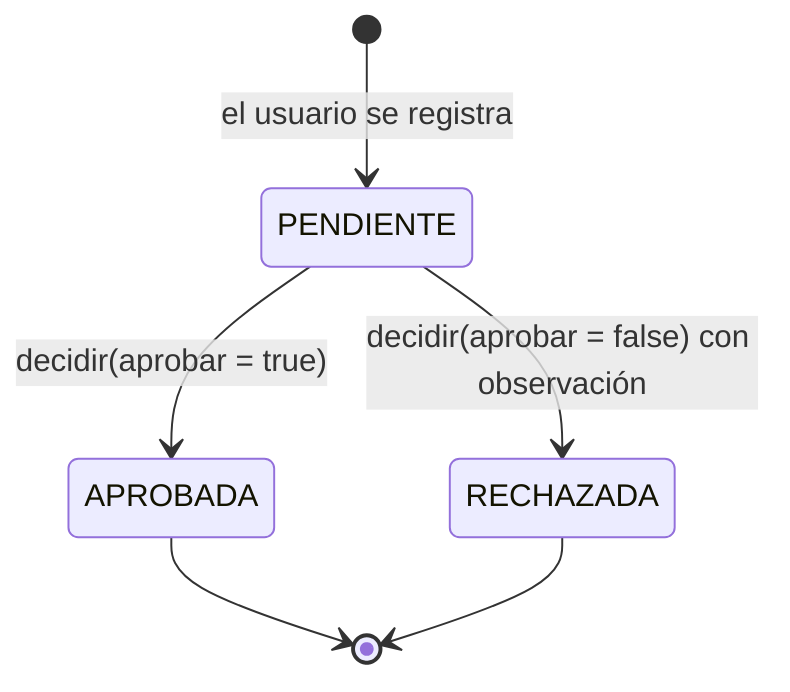
