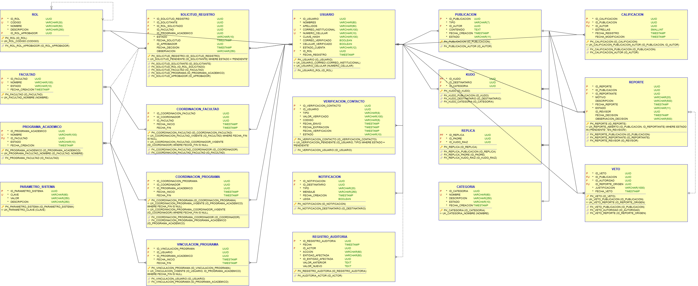

# 11. Modelo de Datos — UCO Kudos

> Traducción del modelo de dominio (secciones 5 y 6) a tablas de **PostgreSQL 16**. Las tablas se crean en el orden de la **línea de vida**.

Archivos:

- Diagrama: [`diagramas/modelo_relacional_kudos.drawio`](diagramas/modelo_relacional_kudos.drawio) (imagen: `diagramas/modelo_relacional_kudos.png`).
- Scripts en [`../db/`](../db/):
  1. `01_esquema_kudos.sql`: crea el esquema `kudos`, las tablas, las restricciones y el trigger de auditoría.
  2. `02_datos_muestreo_kudos.sql`: carga los datos de muestreo de las hojas M- del modelo enriquecido.
  3. `03_pruebas_restricciones.sql`: 20 casos que la base de datos **debe rechazar**.



## 11.1 Decisiones de diseño

| # | Decisión | Por qué |
|---|---|---|
| M1 | Identificadores **UUID** generados con `gen_random_uuid()`. | Mismo tipo que usa el molde del curso (`UtilUUID`); no son adivinables ni dependen de una secuencia. |
| M2 | Herencia de `Publicacion` con **una tabla por clase**: `PUBLICACION` (datos comunes) + `KUDO` y `REPLICA`, que comparten el mismo identificador. `PUBLICACION.TIPO` indica cuál es. | Calificación, Reporte, Veto y el padre de una Réplica apuntan con **una sola FK** a `PUBLICACION`. Con una sola tabla sobrarían columnas vacías; con tablas separadas sin madre no se podría tener una FK única. |
| M3 | Los estados y valores fijos (estado, motivo, tipo) son `VARCHAR` con `CHECK`, no tablas catálogo. `ROL` sí es tabla. | Son valores que nadie gestiona desde la plataforma (KISS). `ROL` es tabla porque guarda datos propios (su rol aprobador). |
| M4 | El historial usa `FECHA_FIN` (vacía = vigente) y **índices únicos parciales** (`UX_...WHERE FECHA_FIN IS NULL`). | Garantiza en la base de datos "un solo coordinador vigente" (INV-003, INV-004) sin borrar la historia (RN-043, RN-051, RN-057). |
| M5 | Todas las FK son **RESTRICT** y no hay borrado físico: se cambia el estado. | Trazabilidad: nada que tenga historia se puede eliminar (decisiones E1 y E6). |
| M6 | El promedio de estrellas **no se guarda**: se calcula con `AVG(ESTRELLAS)`. | Evita datos duplicados que se desactualicen (supuesto 5 del modelo anémico). |
| M7 | `REGISTRO_AUDITORIA` es **inmutable** gracias a un trigger, y `ID_ENTIDAD_AFECTADA` no tiene FK. | AUD-P-0001; la auditoría registra cualquier tipo de objeto, por eso la referencia es genérica. |
| M8 | La base de datos es la **última línea de defensa**: las reglas que necesitan varias tablas o la lógica del flujo se validan en la capa de **negocio**. | Ver 11.4. Ejemplos: autor ≠ destinatario (el autor está en otra tabla), Rector único activo, categoría activa al crear el Kudo y transiciones válidas de estado. |

## 11.2 Tablas

| Tabla | Línea de vida | Objeto de dominio | Descripción | Llaves foráneas |
|---|---|---|---|---|
| `ROL` | 1 | Rol | Roles institucionales (catálogo fijo de 7). | ID_ROL_APROBADOR → ROL |
| `FACULTAD` | 1 | Facultad | Unidades académicas que agrupan programas. | — |
| `CATEGORIA` | 1 | Categoria | Clasificaciones institucionales de reconocimiento. | — |
| `PARAMETRO_SISTEMA` | 1 | ParametroSistema | Parámetros globales que gestiona el Administrador. | — |
| `USUARIO` | 2 | Usuario | Personas de la comunidad; un solo rol por usuario. | ID_ROL → ROL |
| `PROGRAMA_ACADEMICO` | 2 | ProgramaAcademico | Programas académicos; cada uno pertenece a una facultad. | ID_FACULTAD → FACULTAD |
| `SOLICITUD_REGISTRO` | 3 | SolicitudRegistro | Solicitudes para ejercer un rol; las decide el rol aprobador. | ID_SOLICITANTE → USUARIO, ID_ROL_SOLICITADO → ROL, ID_FACULTAD → FACULTAD, ID_PROGRAMA_ACADEMICO → PROGRAMA_ACADEMICO, ID_APROBADOR → USUARIO |
| `VERIFICACION_CONTACTO` | 3 | VerificacionContacto | Códigos temporales para validar correo y celular. | ID_USUARIO → USUARIO |
| `COORDINACION_FACULTAD` | 3 | CoordinacionFacultad | Historial de coordinadores de facultad; fecha fin vacía = vigente. | ID_COORDINADOR → USUARIO, ID_FACULTAD → FACULTAD |
| `COORDINACION_PROGRAMA` | 3 | CoordinacionPrograma | Historial de coordinadores de programa academico; fecha fin vacía = vigente. | ID_COORDINADOR → USUARIO, ID_PROGRAMA_ACADEMICO → PROGRAMA_ACADEMICO |
| `VINCULACION_PROGRAMA` | 3 | VinculacionPrograma | Historial de pertenencia de estudiantes y docentes a programas. | ID_USUARIO → USUARIO, ID_PROGRAMA_ACADEMICO → PROGRAMA_ACADEMICO |
| `PUBLICACION` | 3 | Publicacion | Superclase de Kudo y Réplica (herencia por tabla de clase). | ID_AUTOR → USUARIO |
| `NOTIFICACION` | 3 | Notificacion | Avisos que reciben los usuarios. | ID_DESTINATARIO → USUARIO |
| `REGISTRO_AUDITORIA` | 3 | RegistroAuditoria | Registro histórico e inmutable de operaciones. | ID_ACTOR → USUARIO |
| `KUDO` | 4 | Kudo | Reconocimientos; comparte identificador con PUBLICACION. | ID_KUDO → PUBLICACION, ID_DESTINATARIO → USUARIO, ID_CATEGORIA → CATEGORIA |
| `CALIFICACION` | 4 | Calificacion | Valoraciones de 1 a 5 estrellas; una por usuario y publicación. | ID_PUBLICACION → PUBLICACION, ID_AUTOR → USUARIO |
| `REPORTE` | 4 | Reporte | Solicitudes de revisión de contenido inapropiado. | ID_PUBLICACION → PUBLICACION, ID_REPORTANTE → USUARIO, ID_REVISOR → USUARIO |
| `REPLICA` | 5 | Replica | Intervenciones en la conversación; comparte identificador con PUBLICACION. | ID_REPLICA → PUBLICACION, ID_PADRE → PUBLICACION, ID_KUDO_RAIZ → KUDO |
| `VETO` | 5 | Veto | Decisiones de inhabilitar contenido; máximo una por publicación. | ID_PUBLICACION → PUBLICACION, ID_AUTORIDAD → USUARIO, ID_REPORTE_ORIGEN → REPORTE |

## 11.3 Restricciones y la política que garantizan

Cada restricción de la base de datos respalda una política del modelo enriquecido (sección 8).

| Tabla | Restricción | Tipo | Regla | Política |
|---|---|---|---|---|
| `ROL` | `UK_ROL_CODIGO` | Única | `CODIGO` | ROL-P-0001 |
| `ROL` | `CK_ROL_CODIGO` | Chequeo | `CODIGO IN ('ADMINISTRADOR', 'RECTOR', 'COORDINADOR_ACADEMICO', 'COORDINADOR_FACULTAD', 'COORDINADOR_PROGRAMA', 'DOCENTE', 'ESTUDIANTE')` | RN-004 |
| `ROL` | `CK_ROL_NOMBRE_LEN` | Chequeo | `LENGTH(TRIM(NOMBRE)) >= 3` | — |
| `FACULTAD` | `UK_FACULTAD_NOMBRE` | Única | `NOMBRE` | FAC-P-0005 |
| `FACULTAD` | `CK_FACULTAD_NOMBRE_LEN` | Chequeo | `LENGTH(TRIM(NOMBRE)) >= 3` | FAC-P-0002 |
| `FACULTAD` | `CK_FACULTAD_ESTADO` | Chequeo | `ESTADO IN ('ACTIVA', 'INACTIVA')` | — |
| `CATEGORIA` | `UK_CATEGORIA_NOMBRE` | Única | `NOMBRE` | CAT-P-0005 |
| `CATEGORIA` | `CK_CATEGORIA_NOMBRE_LEN` | Chequeo | `LENGTH(TRIM(NOMBRE)) >= 3` | CAT-P-0002 |
| `CATEGORIA` | `CK_CATEGORIA_DESCRIPCION_LEN` | Chequeo | `LENGTH(TRIM(DESCRIPCION)) >= 10` | CAT-P-0002 |
| `CATEGORIA` | `CK_CATEGORIA_ESTADO` | Chequeo | `ESTADO IN ('ACTIVA', 'INACTIVA')` | CAT-P-0007 |
| `PARAMETRO_SISTEMA` | `UK_PARAMETRO_CLAVE` | Única | `CLAVE` | PAR-P-0001 |
| `PARAMETRO_SISTEMA` | `CK_PARAMETRO_CLAVE_FORMATO` | Chequeo | `CLAVE ~ '^[A-Z][A-Z_]+$'` | PAR-P-0002 |
| `USUARIO` | `UK_USUARIO_CORREO` | Única | `CORREO_INSTITUCIONAL` | USU-P-0005 |
| `USUARIO` | `UK_USUARIO_CELULAR` | Única | `NUMERO_CELULAR` | USU-P-0006 |
| `USUARIO` | `CK_USUARIO_NOMBRES_LEN` | Chequeo | `LENGTH(TRIM(NOMBRES)) >= 2` | USU-P-0002 |
| `USUARIO` | `CK_USUARIO_APELLIDOS_LEN` | Chequeo | `LENGTH(TRIM(APELLIDOS)) >= 2` | USU-P-0002 |
| `USUARIO` | `CK_USUARIO_CORREO_FORMATO` | Chequeo | `CORREO_INSTITUCIONAL ~ '^[A-Za-z0-9._%+-]+@[A-Za-z0-9.-]+\.[A-Za-z]{2,}$'` | USU-P-0004 |
| `USUARIO` | `CK_USUARIO_CELULAR_FORMATO` | Chequeo | `NUMERO_CELULAR ~ '^3[0-9]{9}$'` | USU-P-0007 |
| `USUARIO` | `CK_USUARIO_ESTADO_CUENTA` | Chequeo | `ESTADO_CUENTA IN ('REGISTRADA', 'ACTIVA', 'SUSPENDIDA', 'DESACTIVADA')` | USU-P-0009 |
| `USUARIO` | `CK_USUARIO_ACTIVA_VERIFICADA` | Chequeo | `ESTADO_CUENTA <> 'ACTIVA' OR (CORREO_VERIFICADO AND CELULAR_VERIFICADO)` | USU-P-0012 |
| `PROGRAMA_ACADEMICO` | `UK_PROGRAMA_FACULTAD_NOMBRE` | Única | `ID_FACULTAD, NOMBRE` | PRO-P-0006 |
| `PROGRAMA_ACADEMICO` | `CK_PROGRAMA_ACADEMICO_NOMBRE_LEN` | Chequeo | `LENGTH(TRIM(NOMBRE)) >= 3` | PRO-P-0002 |
| `PROGRAMA_ACADEMICO` | `CK_PROGRAMA_ACADEMICO_ESTADO` | Chequeo | `ESTADO IN ('ACTIVA', 'INACTIVA')` | — |
| `SOLICITUD_REGISTRO` | `UX_SOLICITUD_PENDIENTE` | Única parcial | `ID_SOLICITANTE WHERE ESTADO = 'PENDIENTE'` | SOL-P-0004 |
| `SOLICITUD_REGISTRO` | `CK_SOLICITUD_REGISTRO_ESTADO` | Chequeo | `ESTADO IN ('PENDIENTE', 'APROBADA', 'RECHAZADA')` | SOL-P-0007 |
| `SOLICITUD_REGISTRO` | `CK_SOLICITUD_NO_AUTOAPROBACION` | Chequeo | `ID_APROBADOR IS NULL OR ID_APROBADOR <> ID_SOLICITANTE` | SOL-P-0006 |
| `SOLICITUD_REGISTRO` | `CK_SOLICITUD_UN_AMBITO` | Chequeo | `ID_FACULTAD IS NULL OR ID_PROGRAMA_ACADEMICO IS NULL` | SOL-P-0003 |
| `SOLICITUD_REGISTRO` | `CK_SOLICITUD_DECISION` | Chequeo | `(ESTADO = 'PENDIENTE' AND ID_APROBADOR IS NULL AND FECHA_DECISION IS NULL) OR (ESTADO <> 'PENDIENTE' AND ID_APROBADOR IS NOT NULL AND FECHA_DECISION IS NOT NULL)` | SOL-P-0007 |
| `SOLICITUD_REGISTRO` | `CK_SOLICITUD_RECHAZO_OBSERVACION` | Chequeo | `ESTADO <> 'RECHAZADA' OR LENGTH(TRIM(COALESCE(OBSERVACION, ''))) >= 10` | SOL-P-0008 |
| `VERIFICACION_CONTACTO` | `UX_VERIFICACION_PENDIENTE` | Única parcial | `ID_USUARIO, TIPO WHERE ESTADO = 'PENDIENTE'` | VER-P-0003 |
| `VERIFICACION_CONTACTO` | `CK_VERIFICACION_TIPO` | Chequeo | `TIPO IN ('CORREO', 'CELULAR')` | VER-P-0001 |
| `VERIFICACION_CONTACTO` | `CK_VERIFICACION_CODIGO` | Chequeo | `CODIGO ~ '^[0-9]{6}$'` | VER-P-0002 |
| `VERIFICACION_CONTACTO` | `CK_VERIFICACION_EXPIRACION` | Chequeo | `FECHA_EXPIRACION > FECHA_ENVIO` | VER-P-0004 |
| `VERIFICACION_CONTACTO` | `CK_VERIFICACION_CONTACTO_ESTADO` | Chequeo | `ESTADO IN ('PENDIENTE', 'VERIFICADA', 'EXPIRADA')` | — |
| `VERIFICACION_CONTACTO` | `CK_VERIFICACION_FECHA` | Chequeo | `ESTADO <> 'VERIFICADA' OR FECHA_VERIFICACION IS NOT NULL` | VER-P-0006 |
| `COORDINACION_FACULTAD` | `UX_COORDINACION_FACULTAD_VIGENTE` | Única parcial | `ID_FACULTAD WHERE FECHA_FIN IS NULL` | CFA-P-0002 |
| `COORDINACION_FACULTAD` | `UX_COORDINACION_FACULTAD_COORDINADOR_VIGENTE` | Única parcial | `ID_COORDINADOR WHERE FECHA_FIN IS NULL` | CFA-P-0005 |
| `COORDINACION_FACULTAD` | `CK_COORDINACION_FACULTAD_FECHAS` | Chequeo | `FECHA_FIN IS NULL OR FECHA_FIN >= FECHA_INICIO` | CFA-P-0001 |
| `COORDINACION_PROGRAMA` | `UX_COORDINACION_PROGRAMA_VIGENTE` | Única parcial | `ID_PROGRAMA_ACADEMICO WHERE FECHA_FIN IS NULL` | CPR-P-0002 |
| `COORDINACION_PROGRAMA` | `UX_COORDINACION_PROGRAMA_COORDINADOR_VIGENTE` | Única parcial | `ID_COORDINADOR WHERE FECHA_FIN IS NULL` | CPR-P-0005 |
| `COORDINACION_PROGRAMA` | `CK_COORDINACION_PROGRAMA_FECHAS` | Chequeo | `FECHA_FIN IS NULL OR FECHA_FIN >= FECHA_INICIO` | CPR-P-0001 |
| `VINCULACION_PROGRAMA` | `UX_VINCULACION_VIGENTE` | Única parcial | `ID_USUARIO, ID_PROGRAMA_ACADEMICO WHERE FECHA_FIN IS NULL` | VIN-P-0003 |
| `VINCULACION_PROGRAMA` | `CK_VINCULACION_FECHAS` | Chequeo | `FECHA_FIN IS NULL OR FECHA_FIN >= FECHA_INICIO` | VIN-P-0005 |
| `PUBLICACION` | `CK_PUBLICACION_TIPO` | Chequeo | `TIPO IN ('KUDO', 'REPLICA')` | PUB-P-0001 |
| `PUBLICACION` | `CK_PUBLICACION_CONTENIDO_LEN` | Chequeo | `LENGTH(TRIM(CONTENIDO)) >= 1` | PUB-P-0003 |
| `PUBLICACION` | `CK_PUBLICACION_ESTADO` | Chequeo | `ESTADO IN ('CREADO', 'VISIBLE', 'REPORTADO', 'EN_REVISION', 'VETADO')` | PUB-P-0004 |
| `NOTIFICACION` | `CK_NOTIFICACION_TIPO` | Chequeo | `TIPO IN ('KUDO_RECIBIDO', 'REPLICA_RECIBIDA', 'SOLICITUD_PENDIENTE', 'SOLICITUD_RESUELTA', 'CONTENIDO_VETADO')` | NOT-P-0001 |
| `CALIFICACION` | `UK_CALIFICACION_PUBLICACION_AUTOR` | Única | `ID_PUBLICACION, ID_AUTOR` | CAL-P-0002 |
| `CALIFICACION` | `CK_CALIFICACION_ESTRELLAS` | Chequeo | `ESTRELLAS BETWEEN 1 AND 5` | CAL-P-0001 |
| `REPORTE` | `UX_REPORTE_ABIERTO` | Única parcial | `ID_PUBLICACION, ID_REPORTANTE WHERE ESTADO IN ('PENDIENTE', 'EN_REVISION')` | RPT-P-0002 |
| `REPORTE` | `CK_REPORTE_MOTIVO` | Chequeo | `MOTIVO IN ('LENGUAJE_OFENSIVO', 'ACOSO', 'DISCRIMINACION', 'SPAM', 'INFORMACION_FALSA', 'OTRO')` | RPT-P-0001 |
| `REPORTE` | `CK_REPORTE_OTRO_DESCRIPCION` | Chequeo | `MOTIVO <> 'OTRO' OR LENGTH(TRIM(COALESCE(DESCRIPCION, ''))) >= 10` | RPT-P-0001 |
| `REPORTE` | `CK_REPORTE_ESTADO` | Chequeo | `ESTADO IN ('PENDIENTE', 'EN_REVISION', 'ACEPTADO', 'RECHAZADO')` | RPT-P-0006 |
| `REPORTE` | `CK_REPORTE_DECISION` | Chequeo | `ESTADO NOT IN ('ACEPTADO', 'RECHAZADO') OR (ID_REVISOR IS NOT NULL AND FECHA_DECISION IS NOT NULL AND LENGTH(TRIM(COALESCE(OBSERVACION_DECISION, ''))) >= 10)` | RPT-P-0007 |
| `REPLICA` | `CK_REPLICA_NO_AUTORREFERENCIA` | Chequeo | `ID_PADRE <> ID_REPLICA` | RPL-P-0003 |
| `VETO` | `UK_VETO_PUBLICACION` | Única | `ID_PUBLICACION` | VET-P-0002 |
| `VETO` | `UK_VETO_REPORTE` | Única | `ID_REPORTE_ORIGEN` | — |
| `VETO` | `CK_VETO_JUSTIFICACION_LEN` | Chequeo | `LENGTH(TRIM(JUSTIFICACION)) >= 20` | VET-P-0003 |
| `REGISTRO_AUDITORIA` | `tg_auditoria_inmutable` | Trigger | `Impide UPDATE y DELETE` | AUD-P-0001 |

## 11.4 Reglas que se validan en la capa de negocio

| Regla | Política | Por qué no está en la base de datos |
|---|---|---|
| Autor y destinatario de un Kudo distintos | KUD-P-0002 | El autor está en `PUBLICACION` y el destinatario en `KUDO`; un CHECK no compara tablas. |
| Un solo Rector y un solo Coord. Académico activos | USU-P-0017 | Depende del código del rol, que está en otra tabla. |
| Categoría activa al crear un Kudo | KUD-P-0003 | Una categoría inactiva sigue siendo válida para los Kudos históricos (RN-145). |
| Transiciones válidas de estado | PUB-P-0004, USU-P-0009 | El CHECK valida el valor, no el paso de un estado a otro. |
| `ID_KUDO_RAIZ` coherente con el padre | RPL-P-0002 | Se calcula al crear la réplica a partir del padre. |
| Ámbito de la solicitud según el rol | SOL-P-0003 | Depende del código del rol solicitado. |
| Permisos por rol y ámbito | USU-P-0016 | Es autorización: corresponde a la capa de seguridad y negocio. |

## 11.5 Cómo ejecutar los scripts

```bash
createdb kudos
psql -d kudos -f db/01_esquema_kudos.sql
psql -d kudos -f db/02_datos_muestreo_kudos.sql
psql -d kudos -f db/03_pruebas_restricciones.sql   # debe mostrar 20 líneas 'OK  rechazado'
```

Evidencia de la ejecución sobre PostgreSQL 16.15: 19 tablas creadas, datos de muestreo cargados y **20 de 20** casos inválidos rechazados.
