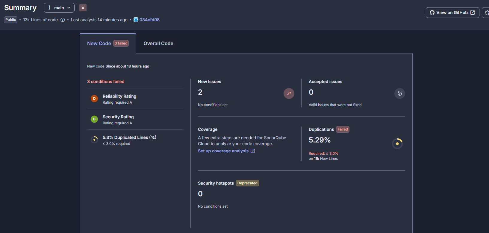
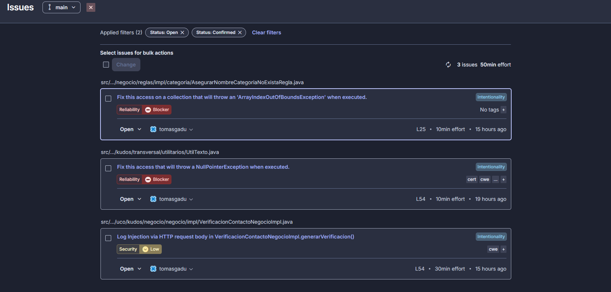
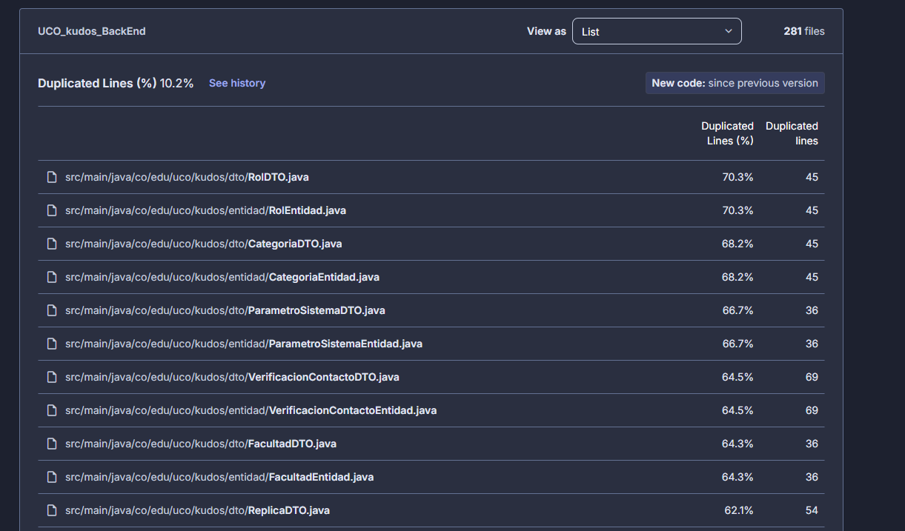
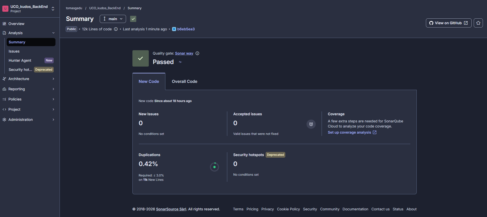
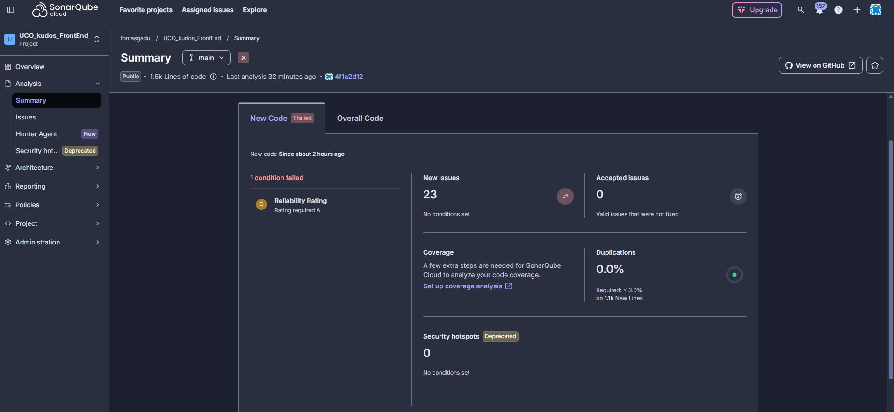
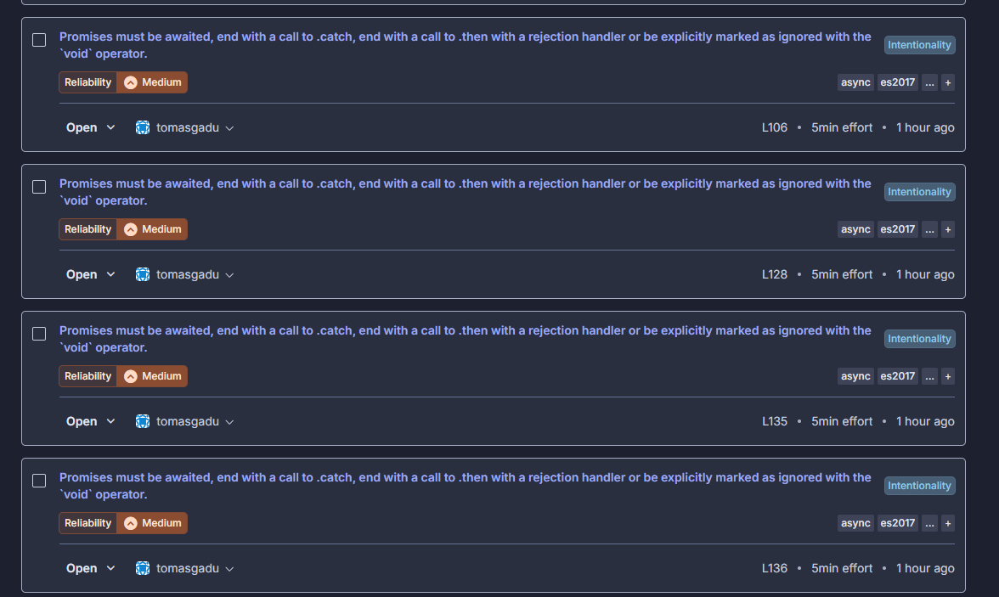
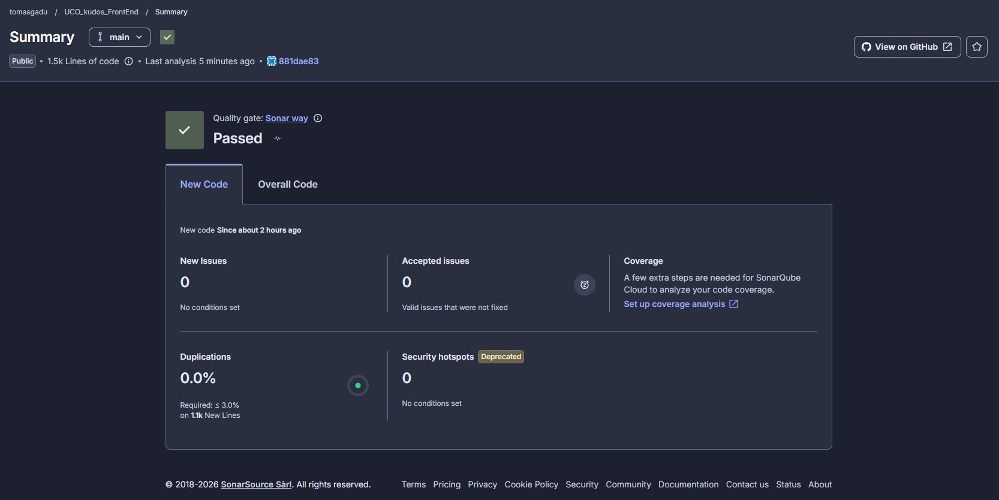

# 15. Análisis estático — UCO Kudos

## 15.1 Herramienta

| Aspecto | Valor |
|---|---|
| Herramienta | SonarQube Cloud (SonarCloud) |
| Proyecto | `tomasgadu_UCO_kudos_BackEnd` (público) |
| Método | Análisis automático: se ejecuta en cada `push` a `main` |
| Reglas | Perfil por defecto *Sonar way* para Java |
| Quality Gate | *Sonar way*: en el código nuevo exige calificaciones A en confiabilidad y seguridad, y duplicación ≤ 3 % |
| Tamaño analizado | ~12 000 líneas de código |

## 15.2 Resultado del primer análisis (antes)

El Quality Gate **falló** con 3 condiciones:

| Condición | Resultado | Requerido |
|---|---|---|
| Reliability Rating | D | A |
| Security Rating | B | A |
| Duplicated Lines (%) | 5,3 % | ≤ 3,0 % |

### Issues encontrados

| # | Archivo | Tipo | Severidad | Problema |
|---|---|---|---|---|
| 1 | `AsegurarNombreCategoriaNoExistaRegla.java` (L25) | Reliability | Blocker | Lectura de `datos[0..2]` sin comprobar el tamaño del arreglo: posible `ArrayIndexOutOfBoundsException`. |
| 2 | `UtilTexto.java` (L54) | Reliability | Blocker | `aplicarMayusculaInicial` usa un valor que podría ser nulo: posible `NullPointerException`. |
| 3 | `VerificacionContactoNegocioImpl.java` (L54) | Security | Low | *Log Injection*: el correo o celular recibido en la petición se escribía directo en el log. |

### Duplicación

Casi toda la duplicación venía de los pares **`XxxDTO` / `XxxEntidad`** (entre 40 % y 70 % de cada archivo).

## 15.3 Correcciones aplicadas

| Issue | Corrección | Principio |
|---|---|---|
| 1 | Nuevo método estático `Regla.validarCantidadDatos(datos, cantidad)`. Si llegan menos datos de los esperados lanza `KudosNegocioExcepcion` con un mensaje controlado del `CatalogoMensajes` en vez de un error 500. | Fallar rápido; DRY: las demás reglas pueden reutilizarlo. |
| 2 | `aplicarMayusculaInicial` valida `esNulo(valor) \|\| valor.isBlank()` antes de operar y devuelve `VACIO`. | Programación defensiva. |
| 3 | Nuevo método `UtilTexto.limpiarParaRegistro(valor)` que reemplaza `\r` y `\n` por `_`; el log usa el valor limpio. | Seguridad (CWE-117). |
| Duplicación | Se excluyeron `**/dto/**` y `**/entidad/**` **solo** del cálculo de duplicación (*Duplication Exclusions*). El resto de reglas sigue analizando esos archivos. | Decisión de arquitectura (ver 15.4). |

Cada corrección se probó en Bruno antes del commit:

| Prueba | Resultado |
|---|---|
| Crear categoría nueva | Éxito |
| Crear categoría con nombre repetido | 400, nombre existente |
| Actualizar mi información con `"  laura   MARÍA "` | 200, `"Laura María"` |
| Actualizar mi información con nombres vacíos | 400, nombres obligatorios |
| Reenviar código de verificación | 200, log con el valor limpio |

Commit: `fix(calidad): Se corrigen los issues de SonarQube de nulos, índices y registro de logs`.

## 15.4 Justificación de la exclusión de duplicación

1. La arquitectura separa el **DTO** (lo que viaja por la API, capa Controlador) de la **Entidad** (lo que se guarda, capa de Datos).
2. Por eso ambas clases tienen los mismos atributos, getters y setters. Es repetición **intencional**, no código copiado por error.
3. Unirlas en una clase común acoplaría la API con la base de datos: un cambio en una tabla cambiaría el contrato de la API.
4. Los **ensambladores** (`EnsambladorDTO`, `EnsambladorEntidad`) son los encargados de convertir entre ellas.
5. Por eso se excluyeron solo de la métrica de duplicación, y la decisión queda documentada aquí.

## 15.5 Resultado final (después)

| Métrica | Antes | Después |
|---|---|---|
| Quality Gate | ❌ Failed (3 condiciones) | ✅ **Passed** |
| Issues abiertos | 3 (2 Blocker, 1 Low) | **0** |
| Reliability Rating | D | A |
| Security Rating | B | A |
| Duplicación (código nuevo) | 5,3 % | **0,42 %** |
| Security Hotspots | 0 | 0 |

## 15.6 Análisis del Front-End

El repositorio `UCO_kudos_FrontEnd` también se analizó con SonarQube Cloud (análisis automático, perfil *Sonar way* para JavaScript, CSS y HTML), porque el enunciado pide analizar **todos** los repositorios (RNF-025).

### Antes

El Quality Gate **falló** por *Reliability Rating* C, con 25 issues de severidad media.

| Tipo | Cantidad | Problema | Corrección |
|---|---|---|---|
| Promesas sin manejar | 19 | Se llamaba a funciones `async` (por ejemplo `cargarMuro();`) sin `await`. Sonar no puede saber si se olvidó esperarlas. | Se marcan con `void` (`void cargarMuro();`): no se esperan a propósito porque cada función ya captura sus errores con `try/catch` y los muestra en pantalla. |
| Campos sin etiqueta | 5 | Inputs de Administración y Auditoría con solo `placeholder`: un lector de pantalla no sabe qué campo es (accesibilidad WCAG 2 A). | Se agregó un `<label for="...">` a cada campo. |
| Encabezado vacío | 1 | `<h2 id="saludo">` empezaba vacío hasta que el JavaScript lo llenaba. | Texto inicial "Bienvenido". |

Commit: `fix(calidad): Se corrigen los issues de SonarQube de promesas sin manejar y accesibilidad`.

### Después

| Métrica | Antes | Después |
|---|---|---|
| Quality Gate | ❌ Failed | ✅ **Passed** |
| Issues | 25 | **0** |
| Reliability Rating | C | A |
| Duplicación | 0,0 % | 0,0 % |

## 15.7 Pendiente

La **cobertura** aparece sin datos porque el análisis automático no ejecuta pruebas. Se configurará con JaCoCo cuando se agreguen las pruebas unitarias (sección [16. Pruebas](16_pruebas.md)).
