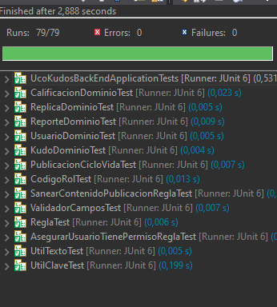
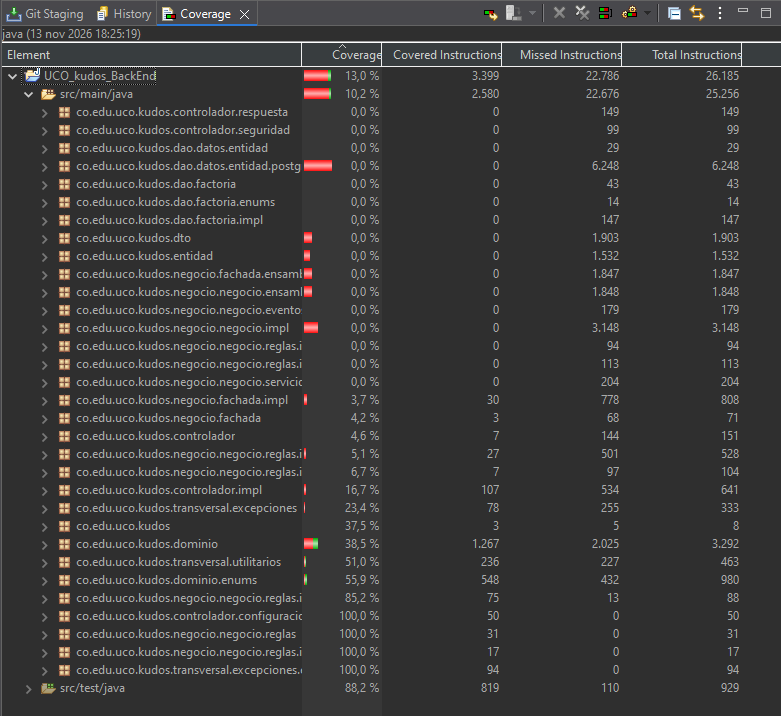

# 16. Pruebas — UCO Kudos

## 16.1 Estrategia

Se usaron dos niveles de prueba, cada uno para lo que mejor sabe probar:

| Nivel | Herramienta | Qué prueba | Por qué |
|---|---|---|---|
| **Unitarias** | JUnit 5 (Jupiter) | Dominio, reglas de negocio, enums con comportamiento y utilitarios | Es donde vive la lógica. Son rápidas, no necesitan base de datos ni levantar Spring, y se ejecutan en cada build. |
| **Integración (API)** | Bruno | Los endpoints de punta a punta: Controlador → Fachada → Negocio → DAO → PostgreSQL | Comprueba que las capas trabajan juntas con la base de datos real y que cada error devuelve el código HTTP correcto. |

Los DAOs, fachadas y controladores **no** tienen pruebas unitarias: su trabajo es coordinar y acceder a la base de datos, y eso se valida con las pruebas de integración en Bruno.

## 16.2 Pruebas unitarias

Ubicación: `src/test/java/co/edu/uco/kudos/`. `FabricaDominioPrueba` construye los objetos de ejemplo (usuario, Kudo) para no repetir ese código en cada clase de prueba.

| Clase de prueba | Qué valida | Casos |
|---|---|---|
| `KudoDominioTest` | Un Kudo nace CREADO; nadie se da un Kudo a sí mismo; publicar CREADO → VISIBLE; el Kudo raíz es él mismo; las transiciones no modifican el original (inmutabilidad). | 6 |
| `ReplicaDominioTest` | La réplica guarda su padre y el Kudo raíz; responder una réplica conserva la raíz; no se responde lo vetado. | 3 |
| `PublicacionCicloVidaTest` | Todo el diagrama de estados de la publicación: reportar, revisar, restaurar, vetar, transiciones inválidas y visibilidad de lo vetado. | 9 |
| `ReporteDominioTest` | Motivo obligatorio; OTRO exige descripción; PENDIENTE → EN_REVISION → ACEPTADO/RECHAZADO; la observación es obligatoria. | 7 |
| `CalificacionDominioTest` | Solo de 1 a 5 estrellas (parametrizada); cambiar la calificación actualiza la fecha de modificación. | 8 |
| `UsuarioDominioTest` | Activar = solicitud aprobada + correo y celular verificados; cambiar el correo o el celular exige verificarlo otra vez. | 5 |
| `CodigoRolTest` | Solo el Rector y el Coordinador Académico vetan; el Administrador no modera; cargos únicos; conversión desde texto. | 10 |
| `ReglaTest` | `validarCantidadDatos` lanza un error controlado en vez de `ArrayIndexOutOfBounds` (corrección de SonarQube). | 4 |
| `AsegurarUsuarioTienePermisoReglaTest` | Permisos por rol. | 3 |
| `SanearContenidoPublicacionReglaTest` | Quita etiquetas HTML y rechaza el contenido vacío. | 5 |
| `ValidadorCamposTest` | Campos obligatorios, longitud, formato del celular e identificador por defecto. | 5 |
| `UtilTextoTest` | Mayúscula inicial, nulos sin `NullPointerException`, limpieza para el log (corrección de SonarQube), formatos de correo y clave. | 8 |
| `UtilClaveTest` | Cifrado BCrypt y código de verificación de 6 dígitos. | 6 |
| `UcoKudosBackEndApplicationTests` | El contexto de Spring Boot arranca. | 1 |
| **Total** | | **79** |

### Técnicas usadas

| Técnica | Dónde |
|---|---|
| Patrón *Arrange–Act–Assert* | Todas las pruebas |
| Pruebas parametrizadas (`@ParameterizedTest`, `@ValueSource`, `@EnumSource`, `@NullSource`) | Estrellas, roles y textos vacíos |
| Valores límite | 0, 1, 5 y 6 estrellas; textos de 9 y 10 caracteres |
| Pruebas de excepción (`assertThrows`) | Cada regla que debe rechazar algo |
| `@DisplayName` en español | Cada caso se lee como la regla de negocio que prueba |

### Resultado

**79 de 79 pruebas exitosas, 0 errores y 0 fallas**, en menos de 4 segundos.

## 16.3 Cobertura

Se midió con **EclEmma (JaCoCo)**, que viene incluido en Eclipse: *Coverage As → JUnit Test*.

| Paquete | Cobertura | Comentario |
|---|---|---|
| `negocio.negocio.reglas` | 100 % | Interfaz `Regla` con `validarCantidadDatos` |
| `negocio.negocio.reglas.impl` (publicación) | 100 % | Saneamiento del contenido |
| `negocio.negocio.reglas.impl` (validador de campos) | 85,2 % | Validaciones de campos |
| `dominio.enums` | 55,9 % | Roles, permisos y estados |
| `transversal.utilitarios` | 51,0 % | Texto, clave, UUID |
| `dominio` | 38,5 % | Se priorizaron Kudo, Réplica, Publicación, Reporte, Calificación y Usuario. Las demás clases son estructura (Builder y getters). |
| DAO, fachada, controlador, DTO, entidad | 0–17 % | Se prueban con Bruno (16.4) |
| **Total `src/main/java`** | **10,2 %** | Bajo porque cuenta las capas de infraestructura |

La cobertura total es baja a propósito: las pruebas unitarias se concentraron en la **lógica de negocio**, que es la que más riesgo tiene. El resto del código se prueba de punta a punta con Bruno.

## 16.4 Pruebas de integración con Bruno

Colección organizada por flujo. El token de sesión se guarda en una variable (`{{tokenLaura}}`, `{{tokenCarlos}}`) con un script posterior al login, y las demás peticiones lo heredan.

| Flujo | Casos probados | Resultado esperado |
|---|---|---|
| Sesión | Login correcto; clave incorrecta; cuenta pendiente; token inválido; petición sin sesión | 200 / 400 / 400 / 401 / 401 |
| Usuarios | Registro, verificación y reenvío de código; consultar y actualizar mi información; mayúscula inicial en los nombres | 200 / 400 en datos inválidos |
| Solicitudes | Consultar pendientes; aprobar; rechazar | 200 |
| Kudos | Dar un Kudo; Kudo a sí mismo; categoría inactiva; contenido vacío; consultar por destinatario y por id | 200 / 400 |
| Réplicas | Responder un Kudo; responder una réplica (mantiene el Kudo raíz); responder lo vetado; ver la conversación | 200 / 400 |
| Calificaciones | Calificar; cambiar la calificación; estrellas fuera de rango; consultar el resumen | 200 / 400 |
| Reportes y vetos | Reportar; reporte duplicado; tomar en revisión; aceptar (produce el veto); rechazar (restaura); vetar lo ya vetado | 200 / 400 |
| Permisos | Estudiante creando una categoría; Administrador vetando | 401 |
| Notificaciones y auditoría | Consultar y marcar como leída; consultar la auditoría con filtros | 200 |
| Peticiones mal formadas | JSON inválido; UUID inválido; método no permitido; ruta inexistente | 400 / 400 / 405 / 404 |

Las capturas de estas pruebas están en el archivo de evidencias.

## 16.5 Cómo ejecutar las pruebas

| Forma | Pasos |
|---|---|
| Eclipse | Clic derecho en `src/test/java` → *Run As → JUnit Test* |
| Eclipse con cobertura | Clic derecho en `src/test/java` → *Coverage As → JUnit Test* → pestaña *Coverage* |
| Maven | `./mvnw test` (en Windows: `mvnw.cmd test`) |
| Bruno | Abrir la colección, ejecutar primero el login y luego cada petición o la carpeta completa |
